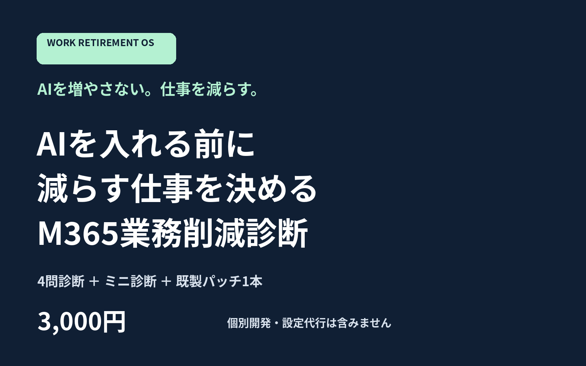
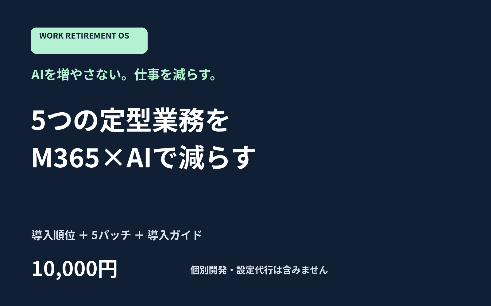
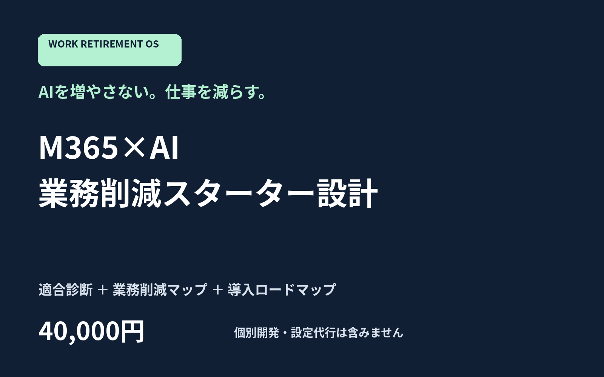

# GO LIVE NOW — Issue #1

## A. RELEASE STATUS

BLOCKED（Square直販とSNS）。実装・販売素材は完成。Issue #1ではココナラFEは公開済み（サービスID4445208）と報告されている。Codex自身は販売者UIへログインしていない。
Squareトークン、送信APIキー、検証済み送信元と受信可能な返信先の提供が必要。実URLと実購入後の回答依頼・ZIP受信は未検証。未検証のリンクや架空URLをSNSへ掲載しない。

## B. 今日公開する順番

### B1. ココナラFE — 既に公開済み

再出品しない。サービスID4445208、価格3,000円、回答受領後3日、同時受付上限10件。集客はサービス内検索のみ。公開操作は不要。以下は既存サービスの入力・取引用完成文面。

価格：3,000円。納期：全回答受領後3日以内。即購入ON、見積り必須OFF、有料オプション・定期購入・ビデオチャットOFF。FE同時受付上限10件。推奨カテゴリ：業務効率化・自動化に相当する相談カテゴリ（現在の分類名は未実確認）。画像：/workspace/work-retirement-os/release/2026-10-10/images/FE.png。返信と納品文は取引の実際のタイミングにトークルームで使用。

#### サービスタイトル

```text
M365で減らせる業務を診断します
```

#### キャッチコピー

```text
AIを増やさない。仕事を減らす。最初の1業務から。
```

#### サービス説明

```text
AIを増やさない。仕事を減らす。

M365で減らせる業務を診断します
表示販売価格：3,000円

「何をAIに任せるか」より先に、減らしたい定型作業を整理します。
対象はM365やExcelを使う担当者です。4問診断＋300〜500字のミニ診断＋既製パッチ1本を、トークルームでの回答に合わせて納品します。

既製パッチは、Forms受付、メール分類・返信案、会議メモ整理、月次報告、VBAの生成・見直し・検証の5種類。回答から1本を選びます。
各パッチにはプロンプト、導入手順、サンプル、受入試験、戻し方を付けます。設定済みの顧客専用システムではありません。

納品：全設問の回答受領後3日以内。やり取り、診断、添付納品、質問はトークルーム内で完結します。
追加対応：納品内容の欠落・破損への対応のみ。運用相談の追加対応は含みません。

顧客専用プログラム開発、既存Excelの個別改修、顧客環境へのログイン、個別システム開発は含みません。
M365・Excel・AIツールの利用料は商品価格に含まれません。機能、ライセンス、権限、管理者ポリシーによって利用可否が変わります。導入や削減効果は保証しません。
ローカルサンプルの動作を検証しています。M365実接続とVBA実機実行は未検証です。購入者の検証領域で試す手順を同梱します。
実績や一定の削減時間を保証する商品ではありません。
```

#### 購入にあたってのお願い

```text
表示販売価格：3,000円。
購入前に利用できるツールと社内の制約を把握してください。不明の場合はトークルームで「不明」を選んでください。
回答は選択肢のみで足ります。実名、勤務先名、連絡先、顧客データ、実ファイル、認証情報は送らないでください。
顧客専用プログラム開発、既存Excelの個別改修、顧客環境へのログイン、個別システム開発は含みません。
M365・Excel・AIツールの利用料は商品価格に含まれません。機能、ライセンス、権限、管理者ポリシーによって利用可否が変わります。導入や削減効果は保証しません。
納品内容の欠落・破損への対応のみ。運用相談の追加対応は含みません。
納品予定：全設問の回答受領後3日以内。回答が届かない間は診断を開始できません。取消や返金はココナラの手続きと適用法令に従います。
```

#### FAQ

```text
Q. ファイルを直してもらえますか？
A. 顧客専用プログラム開発、既存Excelの個別改修、顧客環境へのログイン、個別システム開発は含みません。

Q. 質問できますか？
A. 納品内容の欠落・破損への対応のみ。運用相談の追加対応は含みません。

Q. 必ず自動化できますか？
A. M365・Excel・AIツールの利用料は商品価格に含まれません。機能、ライセンス、権限、管理者ポリシーによって利用可否が変わります。導入や削減効果は保証しません。

Q. 診断はどこで受けますか？
A. トークルームの選択肢に回答していただきます。納品もトークルーム内です。

Q. 実データは必要ですか？
A. 不要です。実名や実ファイルは送らないでください。

Q. 何本のパッチが届きますか？
A. 1本です。各パッチは既製の手順・プロンプト・サンプルです。
```

#### 購入後最初の返信文

```text
ご購入ありがとうございます。診断のため、次の選択肢だけをこのトークルームへ返信してください。

1. 最初に減らしたい作業を1つ選んでください。
A 回答の転記・通知 / B メールの仕分け・返信案 / C 会議メモの整理 / D 月次集計・報告 / E VBAの作成・見直し
2. 利用できる環境を選んでください（複数可）。
M365 / Excelデスクトップ / Excel Web / Forms / Teams / Power Automate / 承認済みAI / 不明
3. 頻度を選んでください。
毎日 / 毎週 / 毎月 / 不定期
4. 導入上の条件を選んでください（複数可）。
外部AIへの入力不可 / マクロ不可 / 管理者承認が必要 / 特に制約なし / 不明

回答は選択肢のみで足ります。実名、勤務先名、連絡先、実データ、認証情報は送らないでください。

全回答の受領後3日以内に、診断結果と既製資産をこのトークルームへ納品します。
```

#### 納品メッセージ

```text
診断結果とFEの納品ZIPを添付しました。診断結果→導入ガイド→対象パッチのSETUP.md→TEST.mdの順にお使いください。原本は変更せず、架空データと複製ファイルで試してください。
本商品のパッチ数は1本です。納品内容の欠落・破損への対応のみ。運用相談の追加対応は含みません。
不足や破損があれば、このトークルームでファイル名をお知らせください。実データや認証情報は不要です。顧客専用プログラム開発、既存Excelの個別改修、顧客環境へのログイン、個別システム開発は含みません。
```

### B2. Square FE — 既存決済リンクを優先

新しいストアは作らない。既存の民泊AI、2,980円、他リンクを変更・停止しない。CodexがAPIで全ページと注文を照合し、商品名・税込総額3,000円JPY・単発決済が一致するリンクを再利用。一致なしの場合だけapplyで1件を冪等作成する。複数一致、価格矛盾、店舗が複数で未選択の場合は自動作成しない。

人間操作1：このチャットの環境設定→保存済み認証・変数欄。Square Developer Dashboardの既存アプリProduction credentialsからSQUARE_ACCESS_TOKENを安全なシークレット欄へ登録（リンク・注文・支払い・店舗・顧客の読み取りと決済リンク作成権限）。既存のResend API Keysから送信・ドメイン・送信履歴を扱えるRESEND_API_KEYを同様に登録。DELIVERY_FROMにResendで検証済みドメインの送信元、DELIVERY_REPLY_TOに実際に受信できる販売者返信先を環境変数欄へ入力。通常のスクリプト・リポジトリを貼り直す必要はない。保存→Publish。既存送信ドメインが未設定の場合はResend DomainsのDNS設定とドメイン所有者の認証が先に必要。認証情報をチャットへ貼らない。

設定後の探索・必要な作成・送信・ZIP生成はCodexが実行する。配送・チップ・定期課金・クーポン・追加税を使わず、3,000円。購入画面の必須同意2欄に商品範囲・利用料別・回答後3日・返金条件を表示し、販売者返信先を連絡先へ設定する。既存リンクに同等の表示がなければ変更せず、宣伝を保留する。
納品条件、返金方針、法定表示は既存の販売者アカウントに実情報で登録されている必要がある。購入画面・法定表示の実表示はAPI照合だけで検証済みとは扱わない。

価格：3,000円、追加税・配送・チップ・定期課金なし。納期：全回答受領後3日以内。画像：/workspace/work-retirement-os/release/2026-10-10/images/FE.png。購入者の決済登録メールへ回答依頼を送り、選択肢回答の受信と診断承認後にZIPを添付送信。Square自身の自動ZIP配布を前提にしない。

#### 商品名

```text
M365で減らせる業務を診断します
```

#### 短い説明

```text
3,000円。4問診断＋300〜500字のミニ診断＋既製パッチ1本。顧客専用プログラム開発、既存Excelの個別改修、顧客環境へのログイン、個別システム開発は含みません。
```

#### 商品説明

```text
M365で減らせる業務を診断します
表示販売価格：3,000円

AIを増やさない。仕事を減らす。
4問診断＋300〜500字のミニ診断＋既製パッチ1本を納品します。
5種類のうち回答に適した1本を選びます。
パッチは設定手順、プロンプト、入力サンプル、期待出力、受入試験、戻し方のセットです。

決済で登録した購入者メールへ診断4問の依頼を送り、メールの返信で回答を受け付けます。全回答の受領後3日以内に診断結果とZIPを手動で納品します。自動ダウンロード商品ではありません。
追加対応：納品内容の欠落・破損への対応のみ。運用相談の追加対応は含みません。

顧客専用プログラム開発、既存Excelの個別改修、顧客環境へのログイン、個別システム開発は含みません。
M365・Excel・AIツールの利用料は商品価格に含まれません。機能、ライセンス、権限、管理者ポリシーによって利用可否が変わります。導入や削減効果は保証しません。
ローカルサンプルを検証しています。M365実接続とVBA実機実行は未検証です。
実名、勤務先、実データ、認証情報は不要です。選択肢だけで回答できます。
回答が届かない場合は決済日から7日目に再案内し、14日目に未納品として取消・全額返金します。
返金は購入時のポリシーと適用法令に従います。未納品・破損・欠落・重複決済は納品依頼メールへの返信で受け付けます。
```

#### 購入後メッセージ

```text
ご購入ありがとうございます。このメールに、次の選択肢だけを返信してください。

1. 最初に減らしたい作業を1つ選んでください。
A 回答の転記・通知 / B メールの仕分け・返信案 / C 会議メモの整理 / D 月次集計・報告 / E VBAの作成・見直し
2. 利用できる環境を選んでください（複数可）。
M365 / Excelデスクトップ / Excel Web / Forms / Teams / Power Automate / 承認済みAI / 不明
3. 頻度を選んでください。
毎日 / 毎週 / 毎月 / 不定期
4. 導入上の条件を選んでください（複数可）。
外部AIへの入力不可 / マクロ不可 / 管理者承認が必要 / 特に制約なし / 不明

回答は選択肢のみで足ります。実名、勤務先名、連絡先、実データ、認証情報は送らないでください。

回答受領後3日以内に手動で診断結果とZIPを納品します。
```

#### 納品メッセージ

```text
ご購入ありがとうございます。診断結果とFEのZIP（既製パッチ1本）を添付しました。導入ガイドと各パッチのTEST.mdに沿って、まず架空データで試してください。
納品内容の欠落・破損への対応のみ。運用相談の追加対応は含みません。
不足・破損があればこのメールへの返信でファイル名をお知らせください。原本、実データ、認証情報は送らないでください。顧客専用プログラム開発、既存Excelの個別改修、顧客環境へのログイン、個別システム開発は含みません。
```

#### 返金方針

```text
返金・取消方針
未納品、重複決済、納品ファイルの欠落・破損は納品依頼メールへの返信で受け付けます。欠落・破損は再納品し、再納品ができない場合は全額返金します。
診断回答がない場合は決済日から7日目に再案内し、14日目に未納品として取消・全額返金します。
正常に納品済みのデジタル資産を購入者都合で取り消す場合、返金をお受けできない場合があります。ただし適用法令・決済規定上の権利を妨げません。
購入前に対応範囲・必要権限・実機未検証箇所を商品説明に表示します。法令・決済規定が本方針に優先します。
```

### B3. SNS — 実決済・納品検証後だけ公開

人間操作2：取得された本番Square決済ページを購入者として開く。商品・総額3,000円・下記の範囲と返金条件・販売者連絡先・法定表示を購入画面で読み、検証を承認する場合だけ決済ボタンを押す。実課金3,000円であり、無断でCodexがカードを操作しない。届いた4問メールに選択肢だけ返信し「送信」。Codexがその回答から診断を作成・承認後にZIPを送る。受信したZIPを開き、欠損なく利用できたかをこの会話へ回答する。配送事業者のdeliveredだけでは人間がZIPを開いた証明にならない。

この結果を踏まえCodexがproductionの実URL入り投稿をlocal_output/sns_liveへ出力する。現時点では実URL未取得なので以下は公開保留。プロフィールのリンク先をその本番URLへ設定してから、X「ポストする」、Instagram「シェア」、Facebook「投稿」。画像は3媒体とも release/2026-10-10/images/FE.png。広告・予約・自動DMはOFF。SNSの公開操作は後続作業であり、今は依頼しない。

#### X：公開保留の草稿

```text
AIを増やさない。仕事を減らす。
新しいAIを探す前に、転記・仕分け・整形のどれを減らすか決める。
まず1つの定型作業を選び、判断は担当者に残す。
M365で減らせる業務を診断します。4問診断・ミニ診断・既製パッチ1本、3,000円。購入はプロフィールのSquareストアから。個別開発は含みません。
```

#### Instagram：公開保留の草稿

```text
AIを増やさない。仕事を減らす。
新しいAIを探す前に、転記・仕分け・整形のどれを減らすか決める。 効果や自動化を保証する商品ではありません。
M365で減らせる業務を診断します。4問診断・ミニ診断・既製パッチ1本、3,000円。購入はプロフィールのSquareストアから。個別開発は含みません。
#M365 #業務改善 #Excel
```

#### Facebook：公開保留の草稿

```text
AIを増やさない。仕事を減らす。
新しいAIを探す前に、転記・仕分け・整形のどれを減らすか決める。
まず1つの定型作業を選び、判断は担当者に残す。
便利なツールを追加するより、同じ入力を何度も扱っていないか見直すところから始めます。既製パッチは手順・サンプル・検証方法をセットにしたものです。顧客環境への設定代行は含みません。
M365で減らせる業務を診断します。4問診断・ミニ診断・既製パッチ1本、3,000円。購入はプロフィールのSquareストアから。個別開発は含みません。
```

### B4. ココナラCORE/PRO — 後日に分離

今回の最短導線には追加しない。完成文面を保持する。追加する場合の価格はCORE10,000円、PRO40,000円。個別開発は含めない。

価格：10,000円。納期：全回答受領後3日以内。即購入ON、見積り必須OFF、有料オプション・定期購入・ビデオチャットOFF。FE同時受付上限10件。推奨カテゴリ：業務効率化・自動化に相当する相談カテゴリ（現在の分類名は未実確認）。画像：/workspace/work-retirement-os/release/2026-10-10/images/CORE.png。返信と納品文は取引の実際のタイミングにトークルームで使用。

#### サービスタイトル

```text
M365定型業務5種の導入手順を届けます
```

#### キャッチコピー

```text
AIを増やさない。仕事を減らす。既製テンプレートで始める。
```

#### サービス説明

```text
AIを増やさない。仕事を減らす。

5つの定型業務をM365×AIで減らす
表示販売価格：10,000円

「何をAIに任せるか」より先に、減らしたい定型作業を整理します。
対象はM365やExcelを使う担当者です。4問診断＋導入順位＋既製パッチ5本を、トークルームでの回答に合わせて納品します。導入ガイドとFAQを付けます。

既製パッチは、Forms受付、メール分類・返信案、会議メモ整理、月次報告、VBAの生成・見直し・検証の5種類。5本すべてを納品します。
各パッチにはプロンプト、導入手順、サンプル、受入試験、戻し方を付けます。設定済みの顧客専用システムではありません。

納品：全設問の回答受領後3日以内。やり取り、診断、添付納品、質問はトークルーム内で完結します。
追加対応：納品後7日以内のテキスト質問1往復（購入者1メッセージへの回答1メッセージ）。

顧客専用プログラム開発、既存Excelの個別改修、顧客環境へのログイン、個別システム開発は含みません。
M365・Excel・AIツールの利用料は商品価格に含まれません。機能、ライセンス、権限、管理者ポリシーによって利用可否が変わります。導入や削減効果は保証しません。
ローカルサンプルの動作を検証しています。M365実接続とVBA実機実行は未検証です。購入者の検証領域で試す手順を同梱します。
実績や一定の削減時間を保証する商品ではありません。
```

#### 購入にあたってのお願い

```text
表示販売価格：10,000円。
購入前に利用できるツールと社内の制約を把握してください。不明の場合はトークルームで「不明」を選んでください。
回答は選択肢のみで足ります。実名、勤務先名、連絡先、顧客データ、実ファイル、認証情報は送らないでください。
顧客専用プログラム開発、既存Excelの個別改修、顧客環境へのログイン、個別システム開発は含みません。
M365・Excel・AIツールの利用料は商品価格に含まれません。機能、ライセンス、権限、管理者ポリシーによって利用可否が変わります。導入や削減効果は保証しません。
納品後7日以内のテキスト質問1往復（購入者1メッセージへの回答1メッセージ）。
納品予定：全設問の回答受領後3日以内。回答が届かない間は診断を開始できません。取消や返金はココナラの手続きと適用法令に従います。
```

#### FAQ

```text
Q. ファイルを直してもらえますか？
A. 顧客専用プログラム開発、既存Excelの個別改修、顧客環境へのログイン、個別システム開発は含みません。

Q. 質問できますか？
A. 納品後7日以内のテキスト質問1往復（購入者1メッセージへの回答1メッセージ）。

Q. 必ず自動化できますか？
A. M365・Excel・AIツールの利用料は商品価格に含まれません。機能、ライセンス、権限、管理者ポリシーによって利用可否が変わります。導入や削減効果は保証しません。

Q. 診断はどこで受けますか？
A. トークルームの選択肢に回答していただきます。納品もトークルーム内です。

Q. 実データは必要ですか？
A. 不要です。実名や実ファイルは送らないでください。

Q. 何本のパッチが届きますか？
A. 5本です。各パッチは既製の手順・プロンプト・サンプルです。
```

#### 購入後最初の返信文

```text
ご購入ありがとうございます。診断のため、次の選択肢だけをこのトークルームへ返信してください。

1. 最初に減らしたい作業を1つ選んでください。
A 回答の転記・通知 / B メールの仕分け・返信案 / C 会議メモの整理 / D 月次集計・報告 / E VBAの作成・見直し
2. 利用できる環境を選んでください（複数可）。
M365 / Excelデスクトップ / Excel Web / Forms / Teams / Power Automate / 承認済みAI / 不明
3. 頻度を選んでください。
毎日 / 毎週 / 毎月 / 不定期
4. 導入上の条件を選んでください（複数可）。
外部AIへの入力不可 / マクロ不可 / 管理者承認が必要 / 特に制約なし / 不明

回答は選択肢のみで足ります。実名、勤務先名、連絡先、実データ、認証情報は送らないでください。

全回答の受領後3日以内に、診断結果と既製資産をこのトークルームへ納品します。
```

#### 納品メッセージ

```text
診断結果とCOREの納品ZIPを添付しました。診断結果→導入ガイド→対象パッチのSETUP.md→TEST.mdの順にお使いください。原本は変更せず、架空データと複製ファイルで試してください。
本商品のパッチ数は5本です。納品後7日以内のテキスト質問1往復（購入者1メッセージへの回答1メッセージ）。
不足や破損があれば、このトークルームでファイル名をお知らせください。実データや認証情報は不要です。顧客専用プログラム開発、既存Excelの個別改修、顧客環境へのログイン、個別システム開発は含みません。
```

価格：40,000円。納期：全回答受領後5日以内。即購入ON、見積り必須OFF、有料オプション・定期購入・ビデオチャットOFF。FE同時受付上限10件。推奨カテゴリ：業務効率化・自動化に相当する相談カテゴリ（現在の分類名は未実確認）。画像：/workspace/work-retirement-os/release/2026-10-10/images/PRO.png。返信と納品文は取引の実際のタイミングにトークルームで使用。

#### サービスタイトル

```text
M365業務削減の導入順序を設計します
```

#### キャッチコピー

```text
AIを増やさない。仕事を減らす。既製テンプレートで始める。
```

#### サービス説明

```text
AIを増やさない。仕事を減らす。

M365×AI 業務削減スターター設計
表示販売価格：40,000円

「何をAIに任せるか」より先に、減らしたい定型作業を整理します。
対象はM365やExcelを使う担当者です。5問適合診断＋業務削減マップ＋既製パッチ5本＋導入ロードマップを、トークルームでの回答に合わせて納品します。AIプロンプト集、M365・Excel・VBA・Forms関連資産、導入ガイド、FAQ、利用条件を付けます。

既製パッチは、Forms受付、メール分類・返信案、会議メモ整理、月次報告、VBAの生成・見直し・検証の5種類。5本すべてを納品します。
各パッチにはプロンプト、導入手順、サンプル、受入試験、戻し方を付けます。設定済みの顧客専用システムではありません。

納品：全設問の回答受領後5日以内。やり取り、診断、添付納品、質問はトークルーム内で完結します。
追加対応：納品後7日以内のテキスト質問1往復（購入者1メッセージへの回答1メッセージ）。

顧客専用プログラム開発、既存Excelの個別改修、顧客環境へのログイン、個別システム開発は含みません。
M365・Excel・AIツールの利用料は商品価格に含まれません。機能、ライセンス、権限、管理者ポリシーによって利用可否が変わります。導入や削減効果は保証しません。
ローカルサンプルの動作を検証しています。M365実接続とVBA実機実行は未検証です。購入者の検証領域で試す手順を同梱します。
実績や一定の削減時間を保証する商品ではありません。
```

#### 購入にあたってのお願い

```text
表示販売価格：40,000円。
購入前に利用できるツールと社内の制約を把握してください。不明の場合はトークルームで「不明」を選んでください。
回答は選択肢のみで足ります。実名、勤務先名、連絡先、顧客データ、実ファイル、認証情報は送らないでください。
顧客専用プログラム開発、既存Excelの個別改修、顧客環境へのログイン、個別システム開発は含みません。
M365・Excel・AIツールの利用料は商品価格に含まれません。機能、ライセンス、権限、管理者ポリシーによって利用可否が変わります。導入や削減効果は保証しません。
納品後7日以内のテキスト質問1往復（購入者1メッセージへの回答1メッセージ）。
納品予定：全設問の回答受領後5日以内。回答が届かない間は診断を開始できません。取消や返金はココナラの手続きと適用法令に従います。
```

#### FAQ

```text
Q. ファイルを直してもらえますか？
A. 顧客専用プログラム開発、既存Excelの個別改修、顧客環境へのログイン、個別システム開発は含みません。

Q. 質問できますか？
A. 納品後7日以内のテキスト質問1往復（購入者1メッセージへの回答1メッセージ）。

Q. 必ず自動化できますか？
A. M365・Excel・AIツールの利用料は商品価格に含まれません。機能、ライセンス、権限、管理者ポリシーによって利用可否が変わります。導入や削減効果は保証しません。

Q. 診断はどこで受けますか？
A. トークルームの選択肢に回答していただきます。納品もトークルーム内です。

Q. 実データは必要ですか？
A. 不要です。実名や実ファイルは送らないでください。

Q. 何本のパッチが届きますか？
A. 5本です。各パッチは既製の手順・プロンプト・サンプルです。
```

#### 購入後最初の返信文

```text
ご購入ありがとうございます。診断のため、次の選択肢だけをこのトークルームへ返信してください。

1. 最初に減らしたい作業を1つ選んでください。
A 回答の転記・通知 / B メールの仕分け・返信案 / C 会議メモの整理 / D 月次集計・報告 / E VBAの作成・見直し
2. 利用できる環境を選んでください（複数可）。
M365 / Excelデスクトップ / Excel Web / Forms / Teams / Power Automate / 承認済みAI / 不明
3. 頻度を選んでください。
毎日 / 毎週 / 毎月 / 不定期
4. 導入上の条件を選んでください（複数可）。
外部AIへの入力不可 / マクロ不可 / 管理者承認が必要 / 特に制約なし / 不明

回答は選択肢のみで足ります。実名、勤務先名、連絡先、実データ、認証情報は送らないでください。

5. 担当者自身で導入を試せる範囲を選んでください。
自分の複製ファイルのみ / チームの検証領域も可 / 管理者との調整が必要 / 不明

全回答の受領後5日以内に、診断結果と既製資産をこのトークルームへ納品します。
```

#### 納品メッセージ

```text
診断結果とPROの納品ZIPを添付しました。診断結果→導入ガイド→対象パッチのSETUP.md→TEST.mdの順にお使いください。原本は変更せず、架空データと複製ファイルで試してください。
本商品のパッチ数は5本です。納品後7日以内のテキスト質問1往復（購入者1メッセージへの回答1メッセージ）。
不足や破損があれば、このトークルームでファイル名をお知らせください。実データや認証情報は不要です。顧客専用プログラム開発、既存Excelの個別改修、顧客環境へのログイン、個別システム開発は含みません。
```

## C. ココナラFE 完全入力セット

既存サービス用。公開済みFEの再出品は不要。

価格：3,000円。納期：全回答受領後3日以内。即購入ON、見積り必須OFF、有料オプション・定期購入・ビデオチャットOFF。FE同時受付上限10件。推奨カテゴリ：業務効率化・自動化に相当する相談カテゴリ（現在の分類名は未実確認）。画像：/workspace/work-retirement-os/release/2026-10-10/images/FE.png。返信と納品文は取引の実際のタイミングにトークルームで使用。

#### サービスタイトル

```text
M365で減らせる業務を診断します
```

#### キャッチコピー

```text
AIを増やさない。仕事を減らす。最初の1業務から。
```

#### サービス説明

```text
AIを増やさない。仕事を減らす。

M365で減らせる業務を診断します
表示販売価格：3,000円

「何をAIに任せるか」より先に、減らしたい定型作業を整理します。
対象はM365やExcelを使う担当者です。4問診断＋300〜500字のミニ診断＋既製パッチ1本を、トークルームでの回答に合わせて納品します。

既製パッチは、Forms受付、メール分類・返信案、会議メモ整理、月次報告、VBAの生成・見直し・検証の5種類。回答から1本を選びます。
各パッチにはプロンプト、導入手順、サンプル、受入試験、戻し方を付けます。設定済みの顧客専用システムではありません。

納品：全設問の回答受領後3日以内。やり取り、診断、添付納品、質問はトークルーム内で完結します。
追加対応：納品内容の欠落・破損への対応のみ。運用相談の追加対応は含みません。

顧客専用プログラム開発、既存Excelの個別改修、顧客環境へのログイン、個別システム開発は含みません。
M365・Excel・AIツールの利用料は商品価格に含まれません。機能、ライセンス、権限、管理者ポリシーによって利用可否が変わります。導入や削減効果は保証しません。
ローカルサンプルの動作を検証しています。M365実接続とVBA実機実行は未検証です。購入者の検証領域で試す手順を同梱します。
実績や一定の削減時間を保証する商品ではありません。
```

#### 購入にあたってのお願い

```text
表示販売価格：3,000円。
購入前に利用できるツールと社内の制約を把握してください。不明の場合はトークルームで「不明」を選んでください。
回答は選択肢のみで足ります。実名、勤務先名、連絡先、顧客データ、実ファイル、認証情報は送らないでください。
顧客専用プログラム開発、既存Excelの個別改修、顧客環境へのログイン、個別システム開発は含みません。
M365・Excel・AIツールの利用料は商品価格に含まれません。機能、ライセンス、権限、管理者ポリシーによって利用可否が変わります。導入や削減効果は保証しません。
納品内容の欠落・破損への対応のみ。運用相談の追加対応は含みません。
納品予定：全設問の回答受領後3日以内。回答が届かない間は診断を開始できません。取消や返金はココナラの手続きと適用法令に従います。
```

#### FAQ

```text
Q. ファイルを直してもらえますか？
A. 顧客専用プログラム開発、既存Excelの個別改修、顧客環境へのログイン、個別システム開発は含みません。

Q. 質問できますか？
A. 納品内容の欠落・破損への対応のみ。運用相談の追加対応は含みません。

Q. 必ず自動化できますか？
A. M365・Excel・AIツールの利用料は商品価格に含まれません。機能、ライセンス、権限、管理者ポリシーによって利用可否が変わります。導入や削減効果は保証しません。

Q. 診断はどこで受けますか？
A. トークルームの選択肢に回答していただきます。納品もトークルーム内です。

Q. 実データは必要ですか？
A. 不要です。実名や実ファイルは送らないでください。

Q. 何本のパッチが届きますか？
A. 1本です。各パッチは既製の手順・プロンプト・サンプルです。
```

#### 購入後最初の返信文

```text
ご購入ありがとうございます。診断のため、次の選択肢だけをこのトークルームへ返信してください。

1. 最初に減らしたい作業を1つ選んでください。
A 回答の転記・通知 / B メールの仕分け・返信案 / C 会議メモの整理 / D 月次集計・報告 / E VBAの作成・見直し
2. 利用できる環境を選んでください（複数可）。
M365 / Excelデスクトップ / Excel Web / Forms / Teams / Power Automate / 承認済みAI / 不明
3. 頻度を選んでください。
毎日 / 毎週 / 毎月 / 不定期
4. 導入上の条件を選んでください（複数可）。
外部AIへの入力不可 / マクロ不可 / 管理者承認が必要 / 特に制約なし / 不明

回答は選択肢のみで足ります。実名、勤務先名、連絡先、実データ、認証情報は送らないでください。

全回答の受領後3日以内に、診断結果と既製資産をこのトークルームへ納品します。
```

#### 納品メッセージ

```text
診断結果とFEの納品ZIPを添付しました。診断結果→導入ガイド→対象パッチのSETUP.md→TEST.mdの順にお使いください。原本は変更せず、架空データと複製ファイルで試してください。
本商品のパッチ数は1本です。納品内容の欠落・破損への対応のみ。運用相談の追加対応は含みません。
不足や破損があれば、このトークルームでファイル名をお知らせください。実データや認証情報は不要です。顧客専用プログラム開発、既存Excelの個別改修、顧客環境へのログイン、個別システム開発は含みません。
```

## D. Square 完全入力セット

外部SNSからの新規流入専用。FE以外は今回登録・決済リンク作成しない。商品名と価格と納期、回答依頼・納品文を以下に全文保持する。

### Square FE

価格：3,000円、追加税・配送・チップ・定期課金なし。納期：全回答受領後3日以内。画像：/workspace/work-retirement-os/release/2026-10-10/images/FE.png。購入者の決済登録メールへ回答依頼を送り、選択肢回答の受信と診断承認後にZIPを添付送信。Square自身の自動ZIP配布を前提にしない。

#### 商品名

```text
M365で減らせる業務を診断します
```

#### 短い説明

```text
3,000円。4問診断＋300〜500字のミニ診断＋既製パッチ1本。顧客専用プログラム開発、既存Excelの個別改修、顧客環境へのログイン、個別システム開発は含みません。
```

#### 商品説明

```text
M365で減らせる業務を診断します
表示販売価格：3,000円

AIを増やさない。仕事を減らす。
4問診断＋300〜500字のミニ診断＋既製パッチ1本を納品します。
5種類のうち回答に適した1本を選びます。
パッチは設定手順、プロンプト、入力サンプル、期待出力、受入試験、戻し方のセットです。

決済で登録した購入者メールへ診断4問の依頼を送り、メールの返信で回答を受け付けます。全回答の受領後3日以内に診断結果とZIPを手動で納品します。自動ダウンロード商品ではありません。
追加対応：納品内容の欠落・破損への対応のみ。運用相談の追加対応は含みません。

顧客専用プログラム開発、既存Excelの個別改修、顧客環境へのログイン、個別システム開発は含みません。
M365・Excel・AIツールの利用料は商品価格に含まれません。機能、ライセンス、権限、管理者ポリシーによって利用可否が変わります。導入や削減効果は保証しません。
ローカルサンプルを検証しています。M365実接続とVBA実機実行は未検証です。
実名、勤務先、実データ、認証情報は不要です。選択肢だけで回答できます。
回答が届かない場合は決済日から7日目に再案内し、14日目に未納品として取消・全額返金します。
返金は購入時のポリシーと適用法令に従います。未納品・破損・欠落・重複決済は納品依頼メールへの返信で受け付けます。
```

#### 購入後メッセージ

```text
ご購入ありがとうございます。このメールに、次の選択肢だけを返信してください。

1. 最初に減らしたい作業を1つ選んでください。
A 回答の転記・通知 / B メールの仕分け・返信案 / C 会議メモの整理 / D 月次集計・報告 / E VBAの作成・見直し
2. 利用できる環境を選んでください（複数可）。
M365 / Excelデスクトップ / Excel Web / Forms / Teams / Power Automate / 承認済みAI / 不明
3. 頻度を選んでください。
毎日 / 毎週 / 毎月 / 不定期
4. 導入上の条件を選んでください（複数可）。
外部AIへの入力不可 / マクロ不可 / 管理者承認が必要 / 特に制約なし / 不明

回答は選択肢のみで足ります。実名、勤務先名、連絡先、実データ、認証情報は送らないでください。

回答受領後3日以内に手動で診断結果とZIPを納品します。
```

#### 納品メッセージ

```text
ご購入ありがとうございます。診断結果とFEのZIP（既製パッチ1本）を添付しました。導入ガイドと各パッチのTEST.mdに沿って、まず架空データで試してください。
納品内容の欠落・破損への対応のみ。運用相談の追加対応は含みません。
不足・破損があればこのメールへの返信でファイル名をお知らせください。原本、実データ、認証情報は送らないでください。顧客専用プログラム開発、既存Excelの個別改修、顧客環境へのログイン、個別システム開発は含みません。
```

#### 返金方針

```text
返金・取消方針
未納品、重複決済、納品ファイルの欠落・破損は納品依頼メールへの返信で受け付けます。欠落・破損は再納品し、再納品ができない場合は全額返金します。
診断回答がない場合は決済日から7日目に再案内し、14日目に未納品として取消・全額返金します。
正常に納品済みのデジタル資産を購入者都合で取り消す場合、返金をお受けできない場合があります。ただし適用法令・決済規定上の権利を妨げません。
購入前に対応範囲・必要権限・実機未検証箇所を商品説明に表示します。法令・決済規定が本方針に優先します。
```

### Square CORE

価格：10,000円、追加税・配送・チップ・定期課金なし。納期：全回答受領後3日以内。画像：/workspace/work-retirement-os/release/2026-10-10/images/CORE.png。購入者の決済登録メールへ回答依頼を送り、選択肢回答の受信と診断承認後にZIPを添付送信。Square自身の自動ZIP配布を前提にしない。

#### 商品名

```text
5つの定型業務をM365×AIで減らす
```

#### 短い説明

```text
10,000円。4問診断＋導入順位＋既製パッチ5本。顧客専用プログラム開発、既存Excelの個別改修、顧客環境へのログイン、個別システム開発は含みません。
```

#### 商品説明

```text
5つの定型業務をM365×AIで減らす
表示販売価格：10,000円

AIを増やさない。仕事を減らす。
4問診断＋導入順位＋既製パッチ5本を納品します。導入ガイドとFAQを付けます。
Forms受付、メール返信案、会議メモ、月次報告、VBAの既製パッチ5本を納品します。
パッチは設定手順、プロンプト、入力サンプル、期待出力、受入試験、戻し方のセットです。

決済で登録した購入者メールへ診断4問の依頼を送り、メールの返信で回答を受け付けます。全回答の受領後3日以内に診断結果とZIPを手動で納品します。自動ダウンロード商品ではありません。
追加対応：納品後7日以内のテキスト質問1往復（購入者1メッセージへの回答1メッセージ）。

顧客専用プログラム開発、既存Excelの個別改修、顧客環境へのログイン、個別システム開発は含みません。
M365・Excel・AIツールの利用料は商品価格に含まれません。機能、ライセンス、権限、管理者ポリシーによって利用可否が変わります。導入や削減効果は保証しません。
ローカルサンプルを検証しています。M365実接続とVBA実機実行は未検証です。
実名、勤務先、実データ、認証情報は不要です。選択肢だけで回答できます。
回答が届かない場合は決済日から7日目に再案内し、14日目に未納品として取消・全額返金します。
返金は購入時のポリシーと適用法令に従います。未納品・破損・欠落・重複決済は納品依頼メールへの返信で受け付けます。
```

#### 購入後メッセージ

```text
ご購入ありがとうございます。このメールに、次の選択肢だけを返信してください。

1. 最初に減らしたい作業を1つ選んでください。
A 回答の転記・通知 / B メールの仕分け・返信案 / C 会議メモの整理 / D 月次集計・報告 / E VBAの作成・見直し
2. 利用できる環境を選んでください（複数可）。
M365 / Excelデスクトップ / Excel Web / Forms / Teams / Power Automate / 承認済みAI / 不明
3. 頻度を選んでください。
毎日 / 毎週 / 毎月 / 不定期
4. 導入上の条件を選んでください（複数可）。
外部AIへの入力不可 / マクロ不可 / 管理者承認が必要 / 特に制約なし / 不明

回答は選択肢のみで足ります。実名、勤務先名、連絡先、実データ、認証情報は送らないでください。

回答受領後3日以内に手動で診断結果とZIPを納品します。
```

#### 納品メッセージ

```text
ご購入ありがとうございます。診断結果とCOREのZIP（既製パッチ5本）を添付しました。導入ガイドと各パッチのTEST.mdに沿って、まず架空データで試してください。
納品後7日以内のテキスト質問1往復（購入者1メッセージへの回答1メッセージ）。
不足・破損があればこのメールへの返信でファイル名をお知らせください。原本、実データ、認証情報は送らないでください。顧客専用プログラム開発、既存Excelの個別改修、顧客環境へのログイン、個別システム開発は含みません。
```

#### 返金方針

```text
返金・取消方針
未納品、重複決済、納品ファイルの欠落・破損は納品依頼メールへの返信で受け付けます。欠落・破損は再納品し、再納品ができない場合は全額返金します。
診断回答がない場合は決済日から7日目に再案内し、14日目に未納品として取消・全額返金します。
正常に納品済みのデジタル資産を購入者都合で取り消す場合、返金をお受けできない場合があります。ただし適用法令・決済規定上の権利を妨げません。
購入前に対応範囲・必要権限・実機未検証箇所を商品説明に表示します。法令・決済規定が本方針に優先します。
```

### Square PRO

価格：40,000円、追加税・配送・チップ・定期課金なし。納期：全回答受領後5日以内。画像：/workspace/work-retirement-os/release/2026-10-10/images/PRO.png。購入者の決済登録メールへ回答依頼を送り、選択肢回答の受信と診断承認後にZIPを添付送信。Square自身の自動ZIP配布を前提にしない。

#### 商品名

```text
M365×AI 業務削減スターター設計
```

#### 短い説明

```text
40,000円。5問適合診断＋業務削減マップ＋既製パッチ5本＋導入ロードマップ。顧客専用プログラム開発、既存Excelの個別改修、顧客環境へのログイン、個別システム開発は含みません。
```

#### 商品説明

```text
M365×AI 業務削減スターター設計
表示販売価格：40,000円

AIを増やさない。仕事を減らす。
5問適合診断＋業務削減マップ＋既製パッチ5本＋導入ロードマップを納品します。AIプロンプト集、M365・Excel・VBA・Forms関連資産、導入ガイド、FAQ、利用条件を付けます。
Forms受付、メール返信案、会議メモ、月次報告、VBAの既製パッチ5本を納品します。
パッチは設定手順、プロンプト、入力サンプル、期待出力、受入試験、戻し方のセットです。

決済で登録した購入者メールへ診断5問の依頼を送り、メールの返信で回答を受け付けます。全回答の受領後5日以内に診断結果とZIPを手動で納品します。自動ダウンロード商品ではありません。
追加対応：納品後7日以内のテキスト質問1往復（購入者1メッセージへの回答1メッセージ）。

顧客専用プログラム開発、既存Excelの個別改修、顧客環境へのログイン、個別システム開発は含みません。
M365・Excel・AIツールの利用料は商品価格に含まれません。機能、ライセンス、権限、管理者ポリシーによって利用可否が変わります。導入や削減効果は保証しません。
ローカルサンプルを検証しています。M365実接続とVBA実機実行は未検証です。
実名、勤務先、実データ、認証情報は不要です。選択肢だけで回答できます。
回答が届かない場合は決済日から7日目に再案内し、14日目に未納品として取消・全額返金します。
返金は購入時のポリシーと適用法令に従います。未納品・破損・欠落・重複決済は納品依頼メールへの返信で受け付けます。
```

#### 購入後メッセージ

```text
ご購入ありがとうございます。このメールに、次の選択肢だけを返信してください。

1. 最初に減らしたい作業を1つ選んでください。
A 回答の転記・通知 / B メールの仕分け・返信案 / C 会議メモの整理 / D 月次集計・報告 / E VBAの作成・見直し
2. 利用できる環境を選んでください（複数可）。
M365 / Excelデスクトップ / Excel Web / Forms / Teams / Power Automate / 承認済みAI / 不明
3. 頻度を選んでください。
毎日 / 毎週 / 毎月 / 不定期
4. 導入上の条件を選んでください（複数可）。
外部AIへの入力不可 / マクロ不可 / 管理者承認が必要 / 特に制約なし / 不明

回答は選択肢のみで足ります。実名、勤務先名、連絡先、実データ、認証情報は送らないでください。

5. 担当者自身で導入を試せる範囲を選んでください。
自分の複製ファイルのみ / チームの検証領域も可 / 管理者との調整が必要 / 不明

回答受領後5日以内に手動で診断結果とZIPを納品します。
```

#### 納品メッセージ

```text
ご購入ありがとうございます。診断結果とPROのZIP（既製パッチ5本）を添付しました。導入ガイドと各パッチのTEST.mdに沿って、まず架空データで試してください。
納品後7日以内のテキスト質問1往復（購入者1メッセージへの回答1メッセージ）。
不足・破損があればこのメールへの返信でファイル名をお知らせください。原本、実データ、認証情報は送らないでください。顧客専用プログラム開発、既存Excelの個別改修、顧客環境へのログイン、個別システム開発は含みません。
```

#### 返金方針

```text
返金・取消方針
未納品、重複決済、納品ファイルの欠落・破損は納品依頼メールへの返信で受け付けます。欠落・破損は再納品し、再納品ができない場合は全額返金します。
診断回答がない場合は決済日から7日目に再案内し、14日目に未納品として取消・全額返金します。
正常に納品済みのデジタル資産を購入者都合で取り消す場合、返金をお受けできない場合があります。ただし適用法令・決済規定上の権利を妨げません。
購入前に対応範囲・必要権限・実機未検証箇所を商品説明に表示します。法令・決済規定が本方針に優先します。
```

## E. SNS 今夜投稿するもの

各媒体の1本を選定済み。実URLと納品検証が成立するまで公開しない。リンク先を創作しない。

#### X：公開保留の草稿

```text
AIを増やさない。仕事を減らす。
新しいAIを探す前に、転記・仕分け・整形のどれを減らすか決める。
まず1つの定型作業を選び、判断は担当者に残す。
M365で減らせる業務を診断します。4問診断・ミニ診断・既製パッチ1本、3,000円。購入はプロフィールのSquareストアから。個別開発は含みません。
```

#### Instagram：公開保留の草稿

```text
AIを増やさない。仕事を減らす。
新しいAIを探す前に、転記・仕分け・整形のどれを減らすか決める。 効果や自動化を保証する商品ではありません。
M365で減らせる業務を診断します。4問診断・ミニ診断・既製パッチ1本、3,000円。購入はプロフィールのSquareストアから。個別開発は含みません。
#M365 #業務改善 #Excel
```

#### Facebook：公開保留の草稿

```text
AIを増やさない。仕事を減らす。
新しいAIを探す前に、転記・仕分け・整形のどれを減らすか決める。
まず1つの定型作業を選び、判断は担当者に残す。
便利なツールを追加するより、同じ入力を何度も扱っていないか見直すところから始めます。既製パッチは手順・サンプル・検証方法をセットにしたものです。顧客環境への設定代行は含みません。
M365で減らせる業務を診断します。4問診断・ミニ診断・既製パッチ1本、3,000円。購入はプロフィールのSquareストアから。個別開発は含みません。
```

## F. 環境設定

Square直販にはB2の秘密変数2つとメール変数2つが必要。既存のインストール・起動・リポジトリ設定を保持して必要条件をドラフト保存する。ドラフト保存と実環境への適用は別。環境設定→認証・変数の入力→保存→Publishで適用する。現行UIの「要確認」表示やPublish完了をこの会話から断定しない。
購入後監視はpoll --watchで実行可能だが、クラウド作業環境の停止中は動作しない。恒久運用のホストは今回未配備。常時完全自動受付や自動返金は約束しない。

## G. 人間総作業時間

ココナラFEは公開済みなので販売開始操作0分。既存のSquareアプリ・Resend検証済み送信ドメイン・受信箱がある場合、環境設定入力約8分＋購入画面と返信・ZIP受信約7分＝操作約15分。実課金への同意、メール待機、DNS認証、アカウント審査、Publish処理、Codexによる診断納品待ちの経過時間は含まない。未設定なら30分以内とは保証しない。
CORE/PROの出品、新規ストア、画像再制作、広告、SNS公開を今回の人間作業から除き、既存資産で最短化した。

FE画像：/workspace/work-retirement-os/release/2026-10-10/images/FE.png



CORE画像：/workspace/work-retirement-os/release/2026-10-10/images/CORE.png



PRO画像：/workspace/work-retirement-os/release/2026-10-10/images/PRO.png


